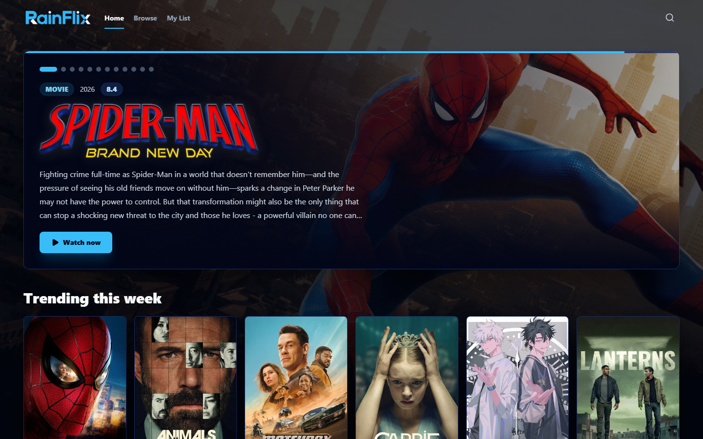

<p align="center">
  
</p>

<h1 align="center">RainFlix</h1>

<p align="center"><strong>Discover on the web. Watch in the app.</strong></p>

<p align="center">
  <a href="https://kanonsoft.github.io/RainFlix/">Explore RainFlix</a> |
  <a href="https://github.com/Kanonsoft/RainFlix/releases">Windows and Android releases</a> |
  <a href="#features">Features</a> |
  <a href="#development">Development</a>
</p>



RainFlix brings movie and series discovery, a personal library, and add-on
playback together in one interface. The React website runs on static hosting;
the Windows and Android apps add native playback and app-owned torrent support.

The website opens with a cinematic introduction and a slow, infinite strip of
movie and series thumbnails with centered title logos from Trending this week,
below One place. Your way. The page backdrop remains fixed while scrolling.
Open RainFlix on web takes you straight to the catalog.
Native apps start at Home.

RainFlix Anime is available after Home on web, Windows and Android, with a
trending hero, weekly top ten, paginated recent episodes and new anime, and an
episode release schedule. Anime uses its own page rather than a Browse type.
Explicit-content filtering depends on TMDb metadata and is not a parental-control guarantee.

## Features

| Experience         | What you get                                                                                                                           |
| ------------------ | -------------------------------------------------------------------------------------------------------------------------------------- |
| Discovery          | Trending titles, newest movies and series, and infinite-scroll Browse with type, genre, and year filters                               |
| Search             | Title, actor, and production searches with scroll-to-load results; blank searches are ignored                                          |
| Title pages        | Title logos, artwork, synopsis, cast, official availability, episodes, streams, and similar titles                                     |
| Personal library   | Persistent My List; native apps also offer Continue Watching and Watched with right-click or long-press actions                        |
| Resume playback    | Fresh source resolution with remembered provider/release preferences, position, subtitles, and audio where supported                   |
| Add-ons            | Separate directory and installed tabs, catalog/stream/subtitle support, cached logos, and native install-link handling                 |
| Series playback    | Season navigation, episode thumbnails, next/previous, automatic next, optional intro/outro skipping, and next-episode preview/prefetch |
| Player controls    | Seek, pause, speed, language-grouped subtitles/audio, subtitle appearance, and episode/provider/source selection                       |
| Native settings    | Reduced animations, fullscreen on Windows, language preferences, playback options, and clear cache                                     |
| Visual polish      | Swipe-following hero transitions, decoded-image background fades, compact mobile cards, and a transparent R startup logo               |
| Reduced animations | Solid charcoal background (`#2d333b`), no movie backdrop, and simplified motion; optional and off by default on Android and Windows    |
| Caching            | Weekly startup poster snapshots with bundled first-install artwork, bounded catalog/artwork caches, and device-local preferences       |

## Platforms

**Web:** React/Vite static build with hash routes, official viewing links, and
the configured Yastream free-stream provider. Add-ons and Settings navigation
are hidden. RainFlix App links direct users to Downloads. Web players and
trailers exit through Back or Escape without extra fullscreen/close overlays.

**Windows x64:** Tauri 2, WebView2, app-owned BitTorrent transport, and bundled
mpv playback with RainFlix controls. Starts maximized; fullscreen is optional.

**Android ARM64:** Tauri 2 with Media3 playback and native torrent transport.
Includes immersive landscape playback, bottom touch controls,
tap-to-toggle controls, and hardware volume control. Codec support depends on the
device and is not identical to Windows mpv. Casting is not implemented.

The website Downloads page detects Windows EXE and Android APK assets from the
latest public, non-prerelease GitHub Release. Landing actions and the web catalog
Downloads link open in new tabs; the landing header contains only the wordmark.

## Development

Use Node.js `22.22.0` or newer and npm. Configure a browser-appropriate TMDb API
key in [`scripts/config.js`](scripts/config.js).

```powershell
npm ci
npm run dev
```

Open the URL printed by Vite. For a static production build:

```powershell
npm run build
npm run preview
```

Build outputs are `dist/` (web), `dist-desktop/` (Windows frontend), and
`dist-mobile/` (Android frontend).

### Native builds

Windows requires Rust/MSVC, Microsoft C++ Build Tools, and WebView2. Android
requires Android Studio, SDK/build tools 36, an NDK, and Rust Android targets.
The checked-in Android project contains customizations; do not regenerate it.

```powershell
npm run desktop:build
npm run android:build
```

The desktop command prepares bundled mpv and builds an NSIS installer. Android
builds a signed ARM64 APK using the local release keystore. Preserve that key
and its properties for all future updates.

See [release instructions](docs/releases/RELEASING.md) for output paths,
publishing steps, signing precautions, and platform-specific release notes.

### Quality checks

```powershell
npm run check
npm run test:e2e
npm run test:pages
```

The latest UI update passed `npm run check` and 132 browser tests. Both native
packages built successfully and APK signing was verified. Browser tests do not
replace installation and playback checks on real devices.

## Configuration and Notes

Start with the [Obsidian index](docs/obsidian/README.md). It links configuration,
architecture, playback, add-ons, settings, and troubleshooting notes.

- Runtime configuration: [`scripts/config.js`](scripts/config.js).
- Shared title pages and playback: [Title Playback](docs/obsidian/Title%20Playback.md).
- Native Android behavior: [Android Native](docs/obsidian/Android%20Native.md).
- Release instructions: [Releasing](docs/releases/RELEASING.md).
- Source disclosure policy: [Source Access](docs/obsidian/Source%20Access.md).

Client configuration and bundled assets can be inspected by recipients.
Never ship private service credentials, signing keys, or reusable secrets.
Fresh stream responses and signed media URLs are not persisted in history or
the service worker. Analytics is optional and kept out of the required startup
module graph so privacy tools cannot prevent the app from loading.

## Routes

```text
#/                            Website introduction
#/home                        Catalog home
#/browse                      Filterable catalog
#/search?q=batman              Search results
#/library                     Personal library
#/title/movie/533535           Movie details and streams
#/title/tv/1399?season=1&episode=1
#/downloads                   Website downloads
#/addons                      Native add-on management
#/settings                    Native preferences
```

Old watch and preview links redirect to shared title pages. Movies, series,
genre, and year routes remain compatible, but Browse replaces those header links.

## Deployment

The GitHub Pages workflow builds and publishes `dist/`. Use GitHub Actions as
the Pages source, not the unbuilt repository root. Repository-path assets are
handled by Vite during Actions builds.

Native installers are separate release assets: a successful Pages deployment
does not upload an EXE or APK. The Windows Downloads page reads the latest
public, non-prerelease release from the configured repository.

Publishing and deployment remain explicit owner tasks. Keep proprietary source
in a private repository; a separate public distribution repository can host
installers without publishing the application source.

## Playback and Limitations

RainFlix does not host a video catalog or guarantee external streams. Native
apps transfer selected torrents locally; source availability, peers, regional
access, subtitles, DRM, and codec support depend on the provider and platform.
Next-episode prefetch preserves provider/release preferences where possible,
but cannot guarantee instant playback. Legacy browser WebTorrent and Stremio
Service adapters remain in the codebase; the old torrent-mode selection UI is
not part of the current stream-selection experience.

Default add-ons install once on native apps, and removed defaults stay removed.
Provider failures are consolidated into one no-streams message, while official
availability retains its regional status.

Use only media and providers for which you have the necessary rights. Review
third-party terms and bundled dependency license/source obligations before
public distribution, including the bundled mpv build.

## Acknowledgements

Metadata and artwork are provided by [The Movie Database](https://www.themoviedb.org/).
This product uses the TMDB API but is not endorsed or certified by TMDB.
RainFlix is independent and is not affiliated with streaming services or add-on providers.
